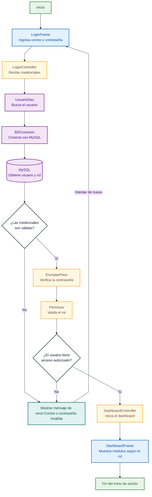

# Diagrama de clases unificado - Campus SIE

## Diagrama de flujo: inicio de sesión




## Capas del sistema

| Capa | Clases principales | Responsabilidad |
|---|---|---|
| **1. Presentación** | `LoginFrame`, `DashboardFrame`, `PanelesModulos` | Capturar acciones del usuario, mostrar formularios y tablas, y presentar mensajes. No ejecuta consultas SQL. |
| **2. Controladores** | `LoginController`, `DashboardController`, controladores específicos de cada módulo | Coordinar eventos de las vistas, validar permisos, llamar a los DAO y actualizar la interfaz. |
| **3. Persistencia y servicios** | `UsuarioDao`, `BDConexion`, `EncriptarPass`, `Permisos` | Conectarse a MySQL, ejecutar operaciones CRUD, transformar datos y proporcionar funcionalidades comunes. |
| **4. Usuarios y perfiles** | `Usuario`, `Rol`, `Estudiante`, `Docente`, `Padre`, `RelPadreEstudiante`, `Notificacion` | Representar las identidades, roles, perfiles y relaciones familiares del sistema. |
| **5. Organización académica** | `Nivel`, `Grado`, `AnioLectivo`, `Periodo`, `Jornada`, `Cursos`, `Materia` | Modelar la estructura educativa, la oferta académica y su organización por año lectivo. |
| **6. Registros académicos** | `Matricula`, `Calificacion`, `Asistencia`, `AsignacionDocente`, `Convivencia`, `Boletin` | Registrar la matrícula, rendimiento, asistencia, asignaciones, convivencia y resultados académicos. |

Cada panel captura los datos ingresados, los presenta al usuario mediante tablas o formularios y delega las operaciones al controlador correspondiente. La presentación no accede directamente a la base de datos ni ejecuta consultas SQL.

## Relaciones entre controladores, vistas y DAO

| Origen | Conecta con | Forma de comunicación |
|---|---|---|
| `DashboardController` | `UsuarioController`, `EstudianteController`, `DocenteController`, `AcudienteController` | Instancia los controladores y les entrega el panel correspondiente. |
| `AcademicoPanel` | `PeriodoController`, `AnioController`, `NivelController`, `GradoController` | Crea los controladores académicos y les pasa su panel y DAO. |
| `CursoMateriaPanel` | `CursoController`, `MateriaController` | Conecta los formularios de cursos y materias con sus controladores. |
| `MatriculaPanel`, `NotasPanel`, `AsistenciaPanel`, `BoletinesPanel`, `ConvivenciaPanel` | Sus respectivos controladores | Cada panel contiene el controlador que administra sus eventos. |
| Cada controlador de módulo | Su DAO específico | El controlador valida datos de la vista y delega las operaciones CRUD al DAO. |

**Flujo principal:** Presentación → Controladores → Persistencia/Servicios → Base de datos → Entidades de modelo.


## Cardinalidad

La cardinalidad indica cuántos objetos pueden participar en cada extremo de una relación.

| Símbolo | Significado |
|---|---|
| `1` | Exactamente una instancia |
| `0..1` | Ninguna o una instancia |
| `1..*` | Una o varias instancias |
| `0..*` | Ninguna o varias instancias |

```mermaid
---
config:
  layout: elk
  elk:
    nodePlacementStrategy: BRANDES_KOEPF
    cycleBreakingStrategy: GREEDY
    mergeEdges: false
  theme: base
  themeVariables:
    primaryColor: "#FFFFFF"
    primaryTextColor: "#172033"
    primaryBorderColor: "#263238"
    lineColor: "#263238"
    secondaryColor: "#FFFFFF"
    tertiaryColor: "#FFFFFF"
    background: "#FFFFFF"
    mainBkg: "#FFFFFF"
    nodeBorder: "#263238"
    clusterBkg: "#FFFFFF"
    clusterBorder: "#455A64"
    edgeLabelBackground: "#FFFFFF"
    fontFamily: "Arial, sans-serif"
    fontSize: "16px"
---
classDiagram
    direction LR

    %% Disposición jerárquica: relaciones agrupadas por responsabilidad
    %% para evitar líneas cruzadas entre capas distintas

    %% Orden visual: 1 presentación → 2 controladores → 3 persistencia
    %%                  → 4 usuarios → 5 organización académica → 6 registros académicos

    classDef default fill:#FFFFFF,stroke:#263238,stroke-width:1.5px,color:#172033
    classDef presentacion fill:#E3F2FD,stroke:#1565C0,stroke-width:2px,color:#0D47A1
    classDef controladores fill:#FFF8E1,stroke:#F9A825,stroke-width:2px,color:#6D4C41
    classDef servicios fill:#F3E5F5,stroke:#7B1FA2,stroke-width:2px,color:#4A148C
    classDef usuarios fill:#E8F5E9,stroke:#2E7D32,stroke-width:1.5px,color:#1B5E20
    classDef academico fill:#FFF3E0,stroke:#EF6C00,stroke-width:1.5px,color:#E65100
    classDef registros fill:#E0F2F1,stroke:#00695C,stroke-width:1.5px,color:#004D40

    namespace 1_Presentacion {
        class LoginFrame:::presentacion {
            <<JFrame>>
            +LoginFrame()
            +mostrarFormularioLogin() void
        }
        class DashboardFrame:::presentacion {
            <<JFrame>>
            -String rol
            +DashboardFrame(String, String, int)
            +mostrarModulo(String) void
        }
        class PanelesModulos:::presentacion {
            <<JPanel>>
            +capturarDatosFormulario() void
            +mostrarTablaDatos() void
            +mostrarMensaje(String) void
        }
    }

    namespace 2_Controladores {
        class LoginController:::controladores {
            +LoginController(UsuarioDao, LoginFrame)
            +actionPerformed(ActionEvent) void
            -realizarLogin() void
        }
        class DashboardController:::controladores {
            +DashboardController(String, String, int)
            +iniciar() void
        }
        class UsuarioController:::controladores {
            +UsuarioController(UsuarioDao, Usuario, UsuarioPanel)
            -configurarEventos() void
            -cargarRoles() void
            -cargarUsuarios() void
            -guardarUsuario() void
            -actualizarUsuario() void
            -eliminarUsuario() void
            -cambiarEstado() void
            -buscarUsuarios() void
            -seleccionarUsuario() void
            -validarFormulario() boolean
        }
        class EstudianteController:::controladores {
            -configurarEventos() void
            -cargarEstudiantes() void
            -buscar() void
            -guardar() void
            -actualizar() void
            -eliminar() void
            -seleccionar() void
            -validar(boolean) boolean
        }
        class DocenteController:::controladores {
            -configurarEventos() void
            -cargarDocentes() void
            -buscar() void
            -guardar() void
            -actualizar() void
            -eliminar() void
            -seleccionar() void
            -validar(boolean) boolean
        }
        class AcudienteController:::controladores {
            -configurarEventos() void
            -cargarAcudientes() void
            -buscar() void
            -guardar() void
            -actualizar() void
            -eliminar() void
            -vincular() void
            -quitarVinculo() void
            -seleccionar() void
            -validar(boolean) boolean
        }
        class GradoController:::controladores {
            +GradoController(GradoFormPanel, GradoDao, NivelDao)
            -configurarEventos() void
            -cargarNiveles() void
            -listarGrados(String) void
            +guardarGrado() void
            +actualizarGrado() void
            +eliminarGrado() void
            +buscarGrados() void
            +mostrarTodos() void
            -seleccionarGrado() void
        }
        class NivelController:::controladores {
            -configurarEventos() void
            -listarTodosLosNiveles() void
            -guardarNivel() void
            -actualizarNivel() void
            -eliminarNivel() void
            -buscarNiveles() void
            -mostrarTodos() void
            -seleccionarNivel() void
        }
        class AnioController:::controladores {
            -configurarEventos() void
            -listarAnios(String) void
            -guardarAnio() void
            -actualizarAnio() void
            -eliminarAnio() void
            -cambiarEstado() void
            -buscarAnios() void
        }
        class PeriodoController:::controladores {
            -configurarFiltroCombo() void
            -initListeners() void
            +mouseClicked(MouseEvent) void
            -cargarComboAnioLectivo() void
            -listarPeriodosEnTabla() void
            -guardarPeriodo() void
            -actualizarPeriodo() void
            -eliminarPeriodo() void
        }
        class CursoController:::controladores {
            +actionPerformed(ActionEvent) void
            -cargarCombos() void
            -listarTodosLosCursos() void
            -capturarDatosDeVista() Cursos
            -validarCampos() boolean
            -limpiarFormulario() void
        }
        class MateriaController:::controladores {
            +actionPerformed(ActionEvent) void
            -listarTodasLasMaterias() void
            -capturarDatosDeVista() Materia
            -validarCampos() boolean
            -limpiarFormulario() void
        }
        class MatriculaController:::controladores {
            +registrarMatricula(Matricula) boolean
            +actualizarMatricula(Matricula) boolean
            +listarMatriculas() List~Matricula~
            +buscarMatricula(String) List~Matricula~
            +eliminarMatricula(int) boolean
        }
        class AsignacionDocenteController:::controladores {
            +registrarAsignacion(AsignacionDocente) boolean
            +actualizarAsignacion(AsignacionDocente) boolean
            +listarAsignaciones(int, int) List~AsignacionDocente~
            +eliminarAsignacion(int) boolean
        }
        class CalificacionController:::controladores {
            +registrarCalificacion(Calificacion) boolean
            +actualizarCalificacion(Calificacion) boolean
            +listarCalificaciones(int, int) List~Calificacion~
            +listarCalificacionesPorMateria(int, int, int) List~Calificacion~
            +eliminarCalificacion(int) boolean
        }
        class BoletinController:::controladores {
            +generarBoletin(Boletin) boolean
            +listarBoletines(int) List~Boletin~
            +actualizarEstadoBoletin(int, String) boolean
            +eliminarBoletin(int) boolean
        }
        class AsistenciaController:::controladores {
            +registrarAsistencia(Asistencia) boolean
            +actualizarAsistencia(Asistencia) boolean
            +listarAsistencias(int, int, int) List~Asistencia~
            +eliminarAsistencia(int) boolean
        }
        class ConvivenciaController:::controladores {
            +registrarConvivencia(Convivencia) boolean
            +actualizarConvivencia(Convivencia) boolean
            +listarConvivencias(int) List~Convivencia~
            +eliminarConvivencia(int) boolean
        }
        class NotificacionController:::controladores {
            +listarUsuariosYRoles() Object[]
            +listarUsuariosActivos(Integer) List~Usuario~
            +listarBandeja(int) List~Notificacion~
            +getCantidadInternas() int
            +getCorreosEnviados() int
            +getErroresCorreo() int
            +getDetalleError() String
        }
    }

    namespace 3_Persistencia_y_Servicios {
        class UsuarioDao:::servicios {
            +login(String, String) Usuario
            +registrarUsuario(Usuario) boolean
            +listaUsuario(String) List~Usuario~
            +listaUsuario() List~Usuario~
            +listaRoles() List~Rol~
            +actualizarUsuario(Usuario) boolean
            +eliminarUsuario(int) boolean
            +cambiarEstadoUsuario(int, boolean) boolean
        }
        class EstudianteDao:::servicios
        class DocenteDao:::servicios
        class PadreDao:::servicios
        class GradoDao:::servicios
        class NivelDao:::servicios
        class AnioLectivoDao:::servicios
        class PeriodoDao:::servicios
        class CursoDao:::servicios
        class MateriaDao:::servicios
        class MatriculaDao:::servicios
        class AsignacionDocenteDao:::servicios
        class CalificacionDao:::servicios
        class AsistenciaDao:::servicios
        class BoletinDao:::servicios
        class ConvivenciaDao:::servicios
        class NotificacionDao:::servicios
        class BDConexion:::servicios {
            <<static>>
            +getConexion() Connection
        }
        class EncriptarPass:::servicios {
            <<static>>
            +encriptarContrasena(String) String
            +verificarContrasena(String, String) boolean
        }
        class Permisos:::servicios {
            <<static>>
            +puedeAcceder(String, String) boolean
        }
    }

    namespace 4_Usuarios {
        class Rol:::usuarios {
            -int idRol
            -String nombreRol
            +getIdRol() int
            +setIdRol(int) void
            +getNombreRol() String
            +setNombreRol(String) void
        }
        class Usuario:::usuarios {
            -int idUsuario
            -String nombre
            -int idRol
            -String correo
            -boolean activo
            +getIdUsuario() int
            +setIdUsuario(int) void
            +getNombre() String
            +setNombre(String) void
        }
        class Estudiante:::usuarios {
            -int idEstudiante
            -int idUsuario
            -String nombre
            -String numDocumento
            -boolean activo
            +getIdEstudiante() int
            +setIdEstudiante(int) void
            +getIdUsuario() int
            +setIdUsuario(int) void
        }
        class Docente:::usuarios {
            -int idDocente
            -String nombre
            -int idUsuario
            -String documento
            +getIdDocente() int
            +setIdDocente(int) void
            +getNombre() String
            +setNombre(String) void
        }
        class Padre:::usuarios {
            -int idPadre
            -int idUsuario
            -String nombre
            -String telefono
            +getIdPadre() int
            +setIdPadre(int) void
            +getIdUsuario() int
            +setIdUsuario(int) void
        }
        class RelPadreEstudiante:::usuarios {
            <<association class>>
            -int idPadre
            -int idEstudiante
            -String parentesco
            +getIdPadre() int
            +setIdPadre(int) void
            +getIdEstudiante() int
            +setIdEstudiante(int) void
        }
        class Notificacion:::usuarios {
            -int idNotificacion
            -int idUsuarioDestino
            -String titulo
            -boolean leido
            +getIdNotificacion() int
            +setIdNotificacion(int) void
            +getIdUsuarioDestino() int
            +setIdUsuarioDestino(int) void
        }
    }

    namespace 5_Organizacion_Academica {
        class Nivel:::academico {
            -int idNivel
            -String nombreNivel
            +getIdNivel() int
            +setIdNivel(int) void
            +getNombreNivel() String
            +setNombreNivel(String) void
        }
        class Grado:::academico {
            -int idGrado
            -short numeroGrado
            -String nombreVisible
            -int idNivel
            +getIdGrado() int
            +setIdGrado(int) void
            +getNumeroGrado() short
            +setNumeroGrado(short) void
        }
        class AnioLectivo:::academico {
            -int idAnio
            -int anio
            -String estado
            +getIdAnio() int
            +setIdAnio(int) void
            +getAnio() int
            +setAnio(int) void
        }
        class Periodo:::academico {
            -int idPeriodo
            -String nombrePeriodo
            -int orden
            -int idAnio
            -boolean activo
            +getIdPeriodo() int
            +setIdPeriodo(int) void
            +getNombrePeriodo() String
            +setNombrePeriodo(String) void
        }
        class Jornada:::academico {
            -int idJornada
            -String nombreJornada
            +getIdJornada() int
            +setIdJornada(int) void
            +getNombreJornada() String
            +setNombreJornada(String) void
        }
        class Cursos:::academico {
            -int idCurso
            -String nombreCurso
            -int idGrado
            -int idAnio
            -int idJornada
            +getIdCurso() int
            +setIdCurso(int) void
            +getNombreCurso() String
            +setNombreCurso(String) void
        }
        class Materia:::academico {
            -int idMateria
            -String nombreMateria
            +getIdMateria() int
            +setIdMateria(int) void
            +getNombreMateria() String
            +setNombreMateria(String) void
        }
    }

    namespace 6_Registros_Academicos {
        class Matricula:::registros {
            -int idMatricula
            -int idEstudiante
            -int idCurso
            -String estado
            +getIdMatricula() int
            +setIdMatricula(int) void
            +getIdEstudiante() int
            +setIdEstudiante(int) void
        }
        class Calificacion:::registros {
            -int idCalificacion
            -int idEstudiante
            -int idMateria
            -int idCurso
            -double nota
            +getIdCalificacion() int
            +setIdCalificacion(int) void
            +getIdEstudiante() int
            +setIdEstudiante(int) void
        }
        class Asistencia:::registros {
            -int idAsistencia
            -int idEstudiante
            -int idCurso
            -Date fechaClase
            -String estado
            +getIdAsistencia() int
            +setIdAsistencia(int) void
            +getIdEstudiante() int
            +setIdEstudiante(int) void
        }
        class AsignacionDocente:::registros {
            -int idAsignacion
            -int idDocente
            -int idMateria
            -int idCurso
            -String estado
            +getIdAsignacion() int
            +setIdAsignacion(int) void
            +getIdDocente() int
            +setIdDocente(int) void
        }
        class Convivencia:::registros {
            -int idConvivencia
            -int idEstudiante
            -int idDocente
            -String tipoFalta
            -String estado
            +getIdConvivencia() int
            +setIdConvivencia(int) void
            +getIdEstudiante() int
            +setIdEstudiante(int) void
        }
        class Boletin:::registros {
            -int idBoletin
            -int idEstudiante
            -int idCurso
            -double promedioGeneral
            -String estadoBoletin
            +getIdBoletin() int
            +setIdBoletin(int) void
            +getIdEstudiante() int
            +setIdEstudiante(int) void
        }
    }

    LoginFrame "1" --> "1" LoginController : envía credenciales
    LoginController "1" --> "1" UsuarioDao : autentica
    LoginController "1" --> "1" DashboardController : inicia sesión
    DashboardController "1" --> "1" DashboardFrame : administra
    DashboardFrame "1" *-- "1..*" PanelesModulos : contiene
    DashboardController "1" --> "0..*" UsuarioController : inicializa usuarios
    DashboardController "1" --> "0..*" EstudianteController : inicializa estudiantes
    DashboardController "1" --> "0..*" DocenteController : inicializa docentes
    DashboardController "1" --> "0..*" AcudienteController : inicializa acudientes

    PanelesModulos "1" --> "0..*" UsuarioController : administra usuarios
    PanelesModulos "1" --> "0..*" GradoController : administra grados
    PanelesModulos "1" --> "0..*" NivelController : administra niveles
    PanelesModulos "1" --> "0..*" AnioController : administra años
    PanelesModulos "1" --> "0..*" PeriodoController : administra periodos
    PanelesModulos "1" --> "0..*" CursoController : administra cursos
    PanelesModulos "1" --> "0..*" MateriaController : administra materias
    PanelesModulos "1" --> "0..*" MatriculaController : administra matrículas
    PanelesModulos "1" --> "0..*" AsignacionDocenteController : administra asignaciones
    PanelesModulos "1" --> "0..*" CalificacionController : administra notas
    PanelesModulos "1" --> "0..*" AsistenciaController : administra asistencia
    PanelesModulos "1" --> "0..*" ConvivenciaController : administra convivencia
    PanelesModulos "1" --> "0..*" BoletinController : administra boletines
    PanelesModulos "1" --> "0..*" NotificacionController : administra notificaciones

    UsuarioController "1" --> "1" UsuarioDao : persiste usuarios
    EstudianteController "1" --> "1" EstudianteDao : persiste estudiantes
    DocenteController "1" --> "1" DocenteDao : persiste docentes
    AcudienteController "1" --> "1" PadreDao : persiste acudientes
    GradoController "1" --> "1" GradoDao : persiste grados
    GradoController "1" --> "1" NivelDao : consulta niveles
    NivelController "1" --> "1" NivelDao : persiste niveles
    AnioController "1" --> "1" AnioLectivoDao : persiste años
    PeriodoController "1" --> "1" PeriodoDao : persiste periodos
    CursoController "1" --> "1" CursoDao : persiste cursos
    MateriaController "1" --> "1" MateriaDao : persiste materias
    MatriculaController "1" --> "1" MatriculaDao : persiste matrículas
    AsignacionDocenteController "1" --> "1" AsignacionDocenteDao : persiste asignaciones
    CalificacionController "1" --> "1" CalificacionDao : persiste calificaciones
    AsistenciaController "1" --> "1" AsistenciaDao : persiste asistencias
    BoletinController "1" --> "1" BoletinDao : persiste boletines
    ConvivenciaController "1" --> "1" ConvivenciaDao : persiste convivencia
    NotificacionController "1" --> "1" NotificacionDao : persiste notificaciones
    UsuarioDao "1" --> "1" BDConexion : obtiene conexión
    LoginController "1" ..> "1" EncriptarPass : valida contraseña
    DashboardController "1" ..> "1" Permisos : verifica permisos

    Rol "1" --> "0..*" Usuario : asigna
    Usuario "1" --> "0..1" Estudiante : representa
    Usuario "1" --> "0..1" Padre : representa
    Usuario "1" --> "0..*" Notificacion : recibe
    Padre "1" --> "0..*" RelPadreEstudiante : mantiene
    Estudiante "1" --> "0..*" RelPadreEstudiante : participa

    Nivel "1" --> "1..*" Grado : agrupa
    Grado "1" --> "0..*" Cursos : contiene
    AnioLectivo "1" --> "1..*" Periodo : divide
    AnioLectivo "1" --> "0..*" Cursos : administra
    Jornada "1" --> "0..*" Cursos : programa

    Estudiante "1" --> "0..*" Matricula : realiza
    Cursos "1" --> "0..*" Matricula : registra
    Estudiante "1" --> "0..*" Calificacion : obtiene
    Materia "1" --> "0..*" Calificacion : evalúa
    Cursos "1" --> "0..*" Calificacion : contiene
    Estudiante "1" --> "0..*" Asistencia : presenta
    Cursos "1" --> "0..*" Asistencia : agrupa
    Docente "1" --> "0..*" AsignacionDocente : recibe
    Materia "1" --> "0..*" AsignacionDocente : se asigna en
    Cursos "1" --> "0..*" AsignacionDocente : incluye
    Estudiante "1" --> "0..*" Convivencia : tiene reportes
    Docente "1" --> "0..*" Convivencia : realiza
    Estudiante "1" --> "0..*" Boletin : obtiene
    Cursos "1" --> "0..*" Boletin : genera
```